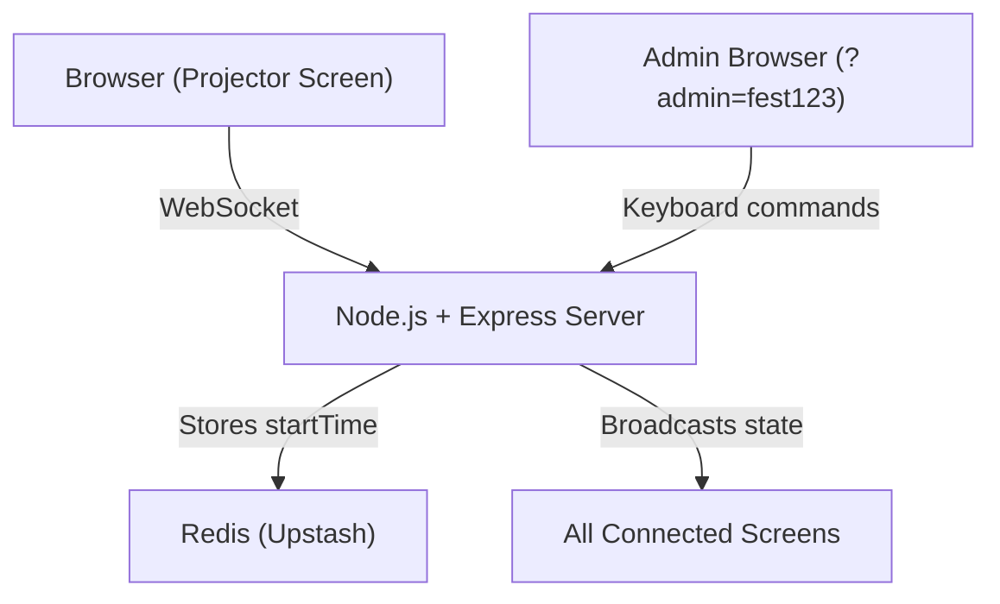

# 🎪 Fest Countdown Timer — Complete Project Summary

## What Is This?
A **real-time synchronized countdown timer** for a college fest (hackathon-style event). It displays a **31-hour countdown** on multiple projector screens, all perfectly synced via WebSockets. An admin can remotely control the timer and play videos on all screens simultaneously.

---

## 🏗️ Architecture



| Component | File | Purpose |
|-----------|------|---------|
| Backend Server | [`server.js`](file:///Users/lt611-18/Desktop/-Countdown-Timer/server.js) | Express + Socket.IO server, manages timer state, admin auth, Redis persistence |
| HTML Page | [`index.html`](file:///Users/lt611-18/Desktop/-Countdown-Timer/fest-screen/index.html) | Single-page layout with header, timer, logo flow, video layer |
| Frontend Logic | [`script.js`](file:///Users/lt611-18/Desktop/-Countdown-Timer/fest-screen/script.js) | Socket connection, clock rendering, logo animation, admin keyboard controls |
| Styles | [`style.css`](file:///Users/lt611-18/Desktop/-Countdown-Timer/fest-screen/style.css) | Full-screen layout, masks, video mode, logo styling |
| Explanation Doc | [`explanation`](file:///Users/lt611-18/Desktop/-Countdown-Timer/explanation) | Technical explanation for presentation/viva |

---

## 📐 Screen Layout (What Goes Where)

### Normal Mode (Timer Screen)
```
┌─────────────────────────────────────────────────┐
│  ████████  HEADER (au.png logo, centered)  ████ │  ← z-index: 20, fixed top, 150px tall
│  ▓▓▓▓▓▓▓▓▓ headerShield (white mask) ▓▓▓▓▓▓▓▓▓ │  ← z-index: 18, hides logos behind header
├─────────────────────────────────────────────────┤
│                                                 │
│   🏷️ 🏷️ 🏷️  ← Sponsor logos scrolling LEFT→RIGHT │  ← z-index: 5 (logoLayer)
│   🏷️ 🏷️ 🏷️     (16 lanes, 45 logos randomly)    │
│   🏷️ 🏷️ 🏷️                                      │
│              ┌──────────────────┐               │
│              │   DAY 2 & DAY 3  │  ← dayLabel   │  ← above timer, centered
│              │   ██ 31:00:00 ██ │  ← clock       │  ← z-index: 15, center of screen
│              │   (white mask)   │  ← timerMask   │  ← z-index: 14, hides logos behind timer
│              └──────────────────┘               │
│   🏷️ 🏷️ 🏷️                                      │
│   🏷️ 🏷️ 🏷️                                      │
│                                                 │
│   ░░░░ readMask (radial fade) ░░░░░░░░░░░░░░░░ │  ← z-index: 10, fades logos at edges
│   ░░░░ focusMask (vignette) ░░░░░░░░░░░░░░░░░░ │  ← z-index: 12, inset box-shadow
└─────────────────────────────────────────────────┘
```

### Video Mode (when a video is playing)
```
┌─────────────────────────────────────────────────┐
│                                   31:00:00 ← ─ ─│ Timer shrinks to 65px, moves to top-right
│                                                 │
│          ┌─────────────────────────┐            │
│          │                         │            │
│          │    ▶ VIDEO (fullscreen)  │            │  ← z-index: 40, covers everything
│          │                         │            │
│          └─────────────────────────┘            │
│                                                 │
│  (header, logos, masks all HIDDEN)              │
└─────────────────────────────────────────────────┘
```

---

## 🏷️ Logo Flow — How It Works

| Property | Value |
|----------|-------|
| Direction | **Left → Right** (logos spawn off-left, scroll rightward) |
| Speed | **40 pixels/second** |
| Total Lanes | **16 horizontal rows** |
| Starting Y | **220px** from top, then every **70px** gap |
| Logo Pool | **45 sponsor logos** (`1.png` to `45.png`) randomly picked |
| Logo Size | **130×70px** each, spaced **240px** apart |
| Recycling | When a logo exits the right edge → it's removed and a new one is added at the left end of that lane |

The logos are **behind** the timer (z-index 5 vs 15). White masks (`timerMask`, `dayMask`, `readMask`, `focusMask`) ensure the timer text stays readable over the moving logos.

---

## 🔐 Admin Access

### How to Become Admin
Add `?admin=fest123` to the URL:
```
https://krk-fest-timer.onrender.com/?admin=fest123
```

| Detail | Value |
|--------|-------|
| Admin Key | `fest123` (hardcoded, also configurable via `ADMIN_KEY` env var) |
| Auth Method | URL query param `?admin=fest123` → sent via Socket.IO `handshake.auth` |
| Server Check | [`server.js:94`](file:///Users/lt611-18/Desktop/-Countdown-Timer/server.js#L94) — `socket.handshake.auth?.admin === ADMIN_KEY` |
| Client Check | [`script.js:7`](file:///Users/lt611-18/Desktop/-Countdown-Timer/fest-screen/script.js#L7) — `params.get("admin") === "fest123"` |

> [!IMPORTANT]
> Without `?admin=fest123` in the URL, **ALL keyboard controls are disabled**. The page becomes a view-only display screen.

---

## ⌨️ Admin Keyboard Controls (Buttons / Keys)

All controls are keyboard-based (no UI buttons). Only work when `?admin=fest123` is in the URL.

| Key | Action | What Happens |
|-----|--------|-------------|
| **`Shift + R`** | 🚀 **Start/Reset Timer** | Shows a confirm dialog → sets `startTime = Date.now()` → saves to Redis → broadcasts to ALL screens → 31-hour countdown begins |
| **`v`** | ▶️ **Play `vid.mp4`** | Plays the main video on all screens, timer shrinks to top-right corner |
| **`1`** | ▶️ **Play `vid1.mp4`** | Plays alternate video 1 on all screens |
| **`2`** | ▶️ **Play `vid2.mp4`** | Plays alternate video 2 on all screens |
| **`s`** | ⏹️ **Stop Video** | Stops any playing video, returns to timer view |
| **`f`** | 🖥️ **Toggle Fullscreen** | Enters/exits browser fullscreen (local only, not broadcast) |

> [!NOTE]
> Videos also auto-stop when they finish playing — the `video.onended` event fires `stopVideo` and removes video mode.

---

## 🎥 Available Video Files

| File | Size | Trigger Key |
|------|------|-------------|
| [`vid.mp4`](file:///Users/lt611-18/Desktop/-Countdown-Timer/fest-screen/assets/videos/vid.mp4) | ~9 MB | `v` |
| [`vid1.mp4`](file:///Users/lt611-18/Desktop/-Countdown-Timer/fest-screen/assets/videos/vid1.mp4) | ~3 MB | `1` |
| [`vid2.mp4`](file:///Users/lt611-18/Desktop/-Countdown-Timer/fest-screen/assets/videos/vid2.mp4) | ~3 MB | `2` |

---

## 🔄 Sync & Recovery System

| Scenario | What Happens |
|----------|-------------|
| New screen connects | Server sends current state immediately |
| Laptop sleeps & wakes | Browser fires `visibilitychange` + `focus` → calls `forceSync` → server sends correct time |
| Server restarts (Render) | `startTime` is in Redis → timer picks up where it left off |
| Every 60 seconds | Auto-resync runs (`setInterval(resync, 60000)`) |

---

## 📁 Asset Summary

- **Header logo**: [`au.png`](file:///Users/lt611-18/Desktop/-Countdown-Timer/fest-screen/assets/logos/au.png) — displayed centered at top
- **Scrolling logos**: `1.png` through `45.png` — sponsor logos flowing left→right
- **Extra logos**: Various AU branding variants (`au black.png`, `au semi final.png`, etc.)
- **QR code**: [`qr.png`](file:///Users/lt611-18/Desktop/-Countdown-Timer/fest-screen/assets/logos/qr.png) — QR overlay layer (hidden by default, z-index 45)
- **Videos**: 3 MP4 files in `assets/videos/`

---

## 🚀 Deployment

| Detail | Value |
|--------|-------|
| Platform | **Render** (cloud hosting) |
| Live URL | `https://krk-fest-timer.onrender.com` |
| Admin URL | `https://krk-fest-timer.onrender.com/?admin=fest123` |
| Redis | **Upstash Redis** (REST API, stores only `eventStart` timestamp) |
| Port | `3000` (or `process.env.PORT`) |
| Start Command | `npm start` → `node server.js` |
